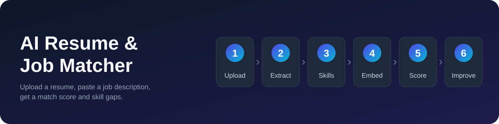
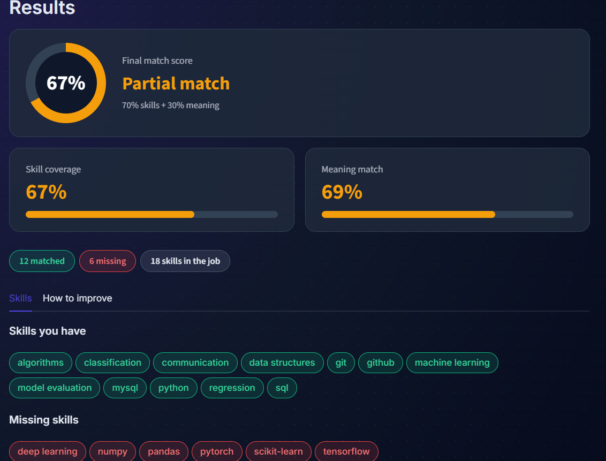
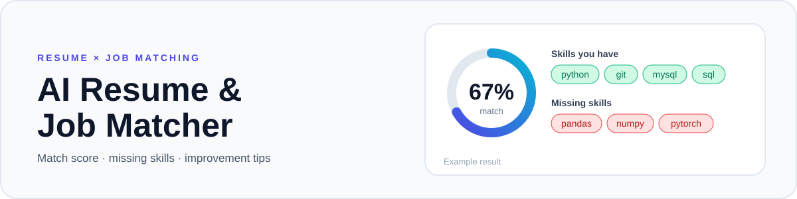

<p align="center">
  
</p>

# AI Resume & Job Matching System
**Live demo:** https://ai-resume-job-matching-system-hya4iomlvvyjeskrntdn4z.streamlit.app/

A web app that compares a resume (PDF) with a job description and shows how well they match: an overall score, the skills the candidate has, the skills that are missing, and tips to improve.

Built with Python, Streamlit, PyMuPDF and Sentence Transformers. The core matching runs locally and needs no paid API.

## Features

- Upload a resume as a PDF and paste a job description
- Text extraction and cleaning (including fixing words split across lines)
- Skill detection against a list of about 270
skills
- Semantic similarity between resume and job description
- Overall match score, skill coverage and meaning match
- Matched and missing skills
- Improvement tips: built-in tips by default, optional AI-written tips
- Warnings for a PDF that does not look like a resume, a scanned PDF, and a job description with few or no known skills

## Screenshot



## How it works

1. **Extract** the text of the uploaded PDF with PyMuPDF.
2. **Clean** the text (extra spaces, blank lines, hyphenated line breaks).
3. **Find skills** in the resume and in the job description by matching against a skills list.
4. **Embed and compare**: the `all-MiniLM-L6-v2` model reads only the first 256 tokens of a text, so both documents are split into chunks. For each job description chunk, the best-matching resume chunk is found with cosine similarity, and the best scores are averaged. This is the meaning match.
5. **Score**: `final = 0.7 x skill coverage + 0.3 x meaning match`.

The 70/30 weighting is a design choice, not a value validated against hiring outcomes. Skill coverage counts a skill as matched if the resume has it or a related one (for example, MySQL counts for SQL).

## Tech stack

Python, Streamlit, PyMuPDF, Sentence Transformers (PyTorch), requests, python-dotenv.

## Project structure

```text
app.py              Streamlit interface
resume_parser.py    PDF text extraction
text_cleaner.py     text cleaning
skills_list.py      skills the app can detect
skill_extractor.py  skill detection
matcher.py          splits text into chunks
match_score.py      meaning match and skill coverage
resume_check.py     checks whether a PDF looks like a resume
suggestions.py      built-in improvement tips
ai_helper.py        optional AI tips with fallback
job_description.txt sample job description
requirements.txt    dependencies
```

## Setup (Windows, PowerShell)

```powershell
git clone https://github.com/Mustafaali04/AI-Resume-Job-Matching-System.git
cd AI-Resume-Job-Matching-System
py -m venv .venv
.venv\Scripts\Activate.ps1
python -m pip install -r requirements.txt
python -m streamlit run app.py
```

Developed and tested on Windows with Python 3.14.4. The first run downloads the embedding model (a small model, roughly 90 MB), so it takes longer.

## Optional: AI-written tips

The app works without any API key. To enable AI tips, create a file named `.env` in the project folder with an OpenRouter key:

```text
OPENROUTER_API_KEY=your_key_here
```

Then tick **Use AI for improvement tips** in the app. It uses OpenRouter's free model router, so the model, and the quality of the tips, can change between runs. Only the job title and the missing skill names are sent, never the resume text. If the call fails, the app uses the built-in tips. The `.env` file is ignored by Git.

<p align="center">
  
</p>

## Example runs

These come from one test resume. They show how the score behaves, not how accurate it is.

| Job description | Final | Skill coverage | Meaning match |
|---|---|---|---|
| Machine Learning Intern | 67% | 67% | 69% |
| Data Analyst Intern | 36% | 29% | 55% |
| Chef de Partie (unrelated) | 6% | N/A | 21% |
| "Python developer" (one line) | 84% | 100% | 47% |

The last row shows a known weakness: a very short job description can give a high score from a single skill. The app shows a warning in that case.

## Limitations

- Skills are found by matching words against a fixed list, so skills outside the list are missed and skills described in other words are not recognized.
- Scanned PDFs (images of text) are not supported. The app shows a message instead of a score.
- The resume check looks for section headings such as Education and Skills, and was tuned on very few examples.
- Tested with only one resume.
- The meaning match is a raw similarity score, not a percentage of fit.

## Future improvements

- OCR for scanned resumes
- A larger or editable skills list
- Weighting required skills above "nice to have" skills
- More testing with different resumes and job descriptions

## Author

Mohammed Mustafa Ali - [GitHub](https://github.com/Mustafaali04)
